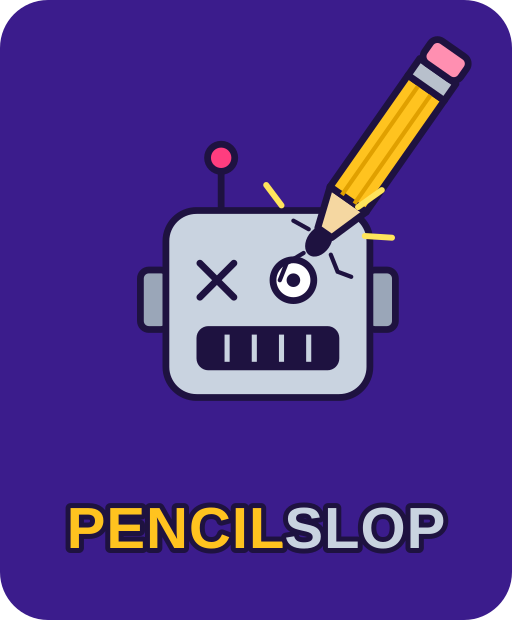

# Pitch

> EDITING DIRECTIVE: DEVELOPER AND AGENT EDIT THIS FILE COLLABORATIVELY. THE DEVELOPER MUST REVIEW AND APPROVE ITS CONTENT. AFTER THE STUDIO DIRECTOR APPROVES THE PITCH, DO NOT EDIT THIS FILE.

Purpose: Explore ideas, choose one, and present it clearly enough for the Studio director to approve its purpose, feasibility, and scope.

## Working agreement

Developer: Bring your interests and ideas, push for range before narrowing, and make the choice yourself. Write the pitch in your own terms and make every scope decision.

Agent: Read the project documents. Help generate and develop ideas, sharpen wording, test feasibility, and point out gaps or risks. Do not choose for the Developer, invent goals, or expand scope.

## Ideation

### Ideas

**AI-or-not art game (chosen).** A web game that shows two artworks side by side; the player decides whether the left, the right, both, or neither is AI-generated.
- Appeal: a timely question everyone has an opinion on, a tight replayable loop, and crowd stats that show how well people actually tell AI from human art.
- For: classmates and general web users curious whether they can spot AI art.
- Feasibility concerns: sourcing enough legally usable real art; reliably confirming that AI images are AI; storing shared vote stats (first backend in my projects); preventing answer leaks through file names or metadata.

**Art-sharing platform with authenticity voting (set aside).** A platform to share art where viewers vote on whether each piece is AI or not.
- Set aside because it was just a discouraging version of something like DeviantArt.

### Choice

I chose the AI-or-not art game because I think it's important to be able to differentiate between what's real and not. It was approved by the Studio director.

Set aside during scoping:
- Using copyrighted art from DeviantArt, Reddit, etc. without permission. Credit and a link are not a license, and publicly labeling a small artist's work "68% thought this was AI" could harm them. Fallback only: a closed, one-day class showing behind access control, which has a fair-use argument but is not automatic.
- Generating AI images live during a round. Pre-generating them in the background is more reliable within a 10-second timer.

### Branding

Chosen title: **PENCILSLOP**

Other title options considered:
- **Real or Rendered**
- **Brushstroke or Prompt**
- **Canvas Check**
- **Spot the Bot**
- **Human Touch**

Visual directions:
- **Gallery wall.** Off-white walls, thin gold frames, a serif display face, museum placard captions for credits. Calm and serious, which helps the art read as art.
- **Detective / forensics.** Dark background, magnifying-glass motif, monospaced type, red "flagged" stamps. Playful and tense, matches the timer.
- **Split-screen duel.** Two contrasting colors, one per side, bold sans-serif, a streak counter as the hero element. Arcade energy.

**Chosen direction: quiz-show energy (Kahoot-inspired), art first.**
- Bold, saturated party-quiz look: deep purple background, chunky rounded sans-serif, a big countdown timer, four color-coded answer buttons each with its own shape.
- Unlike Kahoot, the images dominate. The two artworks take most of the screen and the answer buttons are a compact strip beneath them, so the art is what players study.
- Answers map to the layout: **Left is AI** sits under the left image, **Right is AI** under the right, **Both** and **Neither** between or below.
- Inspired by the genre, not copied: original name, logo, colors, and icons, with no Kahoot assets or trademarks.

## Pitch

### Concept

A fast web game: two artworks appear side by side, and within 10 seconds the player picks **Left is AI**, **Right is AI**, **Both**, or **Neither**. A correct answer extends the streak; one wrong answer ends the run. After each round the game reveals the truth, credits and links the real art's source, and shows what percentage of earlier players judged each work as AI. Rounds get harder as the run goes on.

### Title and branding

Working title: **PENCILSLOP**. Logo: a giant pencil stabbed into a robot head ([branding/logo.svg](branding/logo.svg)).

Visual branding: a bright, Kahoot-style quiz-show look (purple background, bold rounded type, color-and-shape answer buttons, big timer), with the two artworks dominating the screen and the answers in a compact strip below. Branding rules will live in `spec.md`.

### Why this project

AI-generated images are everywhere, and most people believe they can spot them. This game tests that belief and shows the crowd's results honestly, round by round. It is worth five weeks because it combines a polished game loop with a real backend, a curated and licensed content pipeline, and a difficulty system driven by player data, each a step beyond my previous static projects.

### Users

Classmates and general web users, on phone or desktop, who want a quick, replayable challenge. They need clear, fast rounds; fair image pairs that can't be solved by file quality or size; honest reveals with proper credit; and no account or personal data required.

### Experience goals

- Players feel the pressure of a 10-second decision and the pull of beating their personal best.
- After each round they notice how they compare with everyone else ("only 31% caught this one").
- Difficulty rises noticeably: early rounds use recognizable museum pieces and obvious AI; later rounds use lesser-known, less technically polished real art and the most convincing AI.
- Players learn the real artist and source of every human work they saw.

### Technical goals

- Game loop: 10-second timer, four-choice answer, streak, run ends on first wrong answer, personal best saved on the device.
- Randomized pairs: each slot is independently AI with a probability between 20% and 60%, so all four answers occur and no pattern can be learned.
- Server-side answers: the browser never receives which image is AI until after the player answers; images are served under neutral IDs with stripped metadata and normalized size and compression.
- Shared stats: every answer is recorded anonymously; the reveal shows per-image percentages, hidden until a minimum vote count is reached.
- Difficulty: hand-assigned tiers at launch (museum → lesser-known openly licensed art; obvious → convincing AI), later re-ranked by how often each image fooled players.
- Content pipeline: a catalog of every image with its source, license, credit, and AI confirmation.

### Starting point

From scratch.

### Tech stack

- **Frontend:** HTML, CSS, and JavaScript with no framework, as in my previous projects. Small enough not to need one.
- **Hosting and backend:** Cloudflare: Pages for the site, Workers for the round/answer/vote API, D1 (SQLite) for votes and the catalog, R2 for images. One platform with a free tier. Workers, D1, and R2 are new to me. Free-tier limits to be verified in research.
- **Real art:** openly licensed sources only: museum open-access collections (e.g. the Met, Art Institute of Chicago, Rijksmuseum), Wikimedia Commons, Flickr Creative Commons, and Creative Commons–licensed DeviantArt works.
- **AI art:** images from public AI generation galleries and posts where the creator explicitly states they are AI-generated (any explicit confirmation counts), plus a small number of images I generate myself in background batches as fill-ins. Each site's terms of use to be checked in research.

### MVP or critical function

The riskiest part is the round → answer → shared-stats loop across the network. MVP: a playable game with a small seed catalog (around 20 real and 20 AI images) where the Worker serves a pair, checks the answer on the server, records the vote in D1, and returns the truth, credit, and crowd percentages. It works when two different devices play and each sees the other's votes reflected in the stats, and when the answer can't be found in the page's network traffic before answering.

### Five-week map

- **Phase 1 (Oct 26–Nov 2):** pitch approved; repository created.
- **Phase 2 (Nov 2–9):** MVP above, deployed to a public Cloudflare URL.
- **Phase 3 (Nov 9–16):** content pipeline and catalog growth with licensing records; difficulty tiers; image normalization; timer, streak, and personal-best polish.
- **Phase 4 (Nov 16–30):** branding and logo applied, full reveal/stats screen, mobile layout, accessibility, data-driven difficulty, larger catalog; peer-review-ready version.
- **Phase 5 (Nov 30–Dec 7):** peer-review fixes, final verification, breakdown, and debrief.

### Stretch goals

1. Data-driven difficulty re-ranking once enough votes exist.
2. Background batch generation of AI images to fill catalog gaps.
3. End-of-run summary (which images fooled you, how you compare with all players).
4. Shareable result card for a streak.

### Risks

- **Not enough openly licensed, lesser-known art.** Find out in Phase 2 by counting usable items from each source.
- **AI confirmation is wrong.** A mislabeled image makes a correct player lose. Keep a source and confirmation note for every image; let players report a pair.
- **Images that give themselves away** through resolution, compression, watermarks, or aspect ratio. Normalize all images and remove watermarks or signatures only where the license allows, otherwise skip the image.
- **Answer leaks** through file names, metadata, or API responses. Neutral IDs and server-side checking; test by inspecting network traffic.
- **Misleading early stats** from few votes. Show percentages only after a minimum count.
- **Cloudflare stack is new to me.** Deploy a hello-world Worker with D1 on day one of Phase 2.
- **Privacy.** Store only anonymous answers: no accounts, no IP addresses, no personal data.
